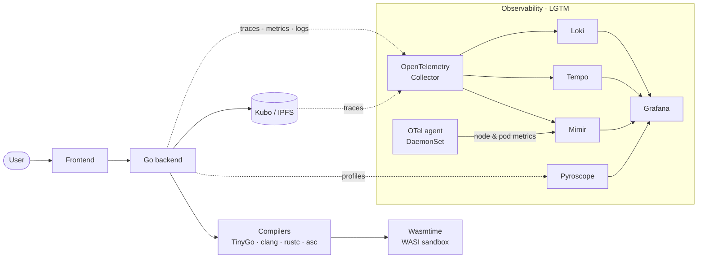

<!-- GitHub Profile README -->

# 👨‍💻 Hi, I'm Vicente

<div align="center">

[](https://git.io/typing-svg)

</div>

---

## 🚀 About Me

I'm a **Software Development student at 42 Luxembourg**. I've **completed the 42 Common Core (100%)** and I'm now in the **42 Advanced** part of the curriculum (level **16.12 / 21**), focusing on backend development, infrastructure, automation and DevOps.

💼 Currently doing a **6-month internship at CACEIS Bank, Luxembourg Branch**.

I enjoy understanding how systems work end-to-end — from writing the application to **containerizing it, automating its delivery, monitoring it and dealing with failures**.

My interest in DevOps grew through hands-on projects such as **Inception** and **ft_lgtm**, and has since developed through personal projects involving CI/CD, Docker, monitoring and automation.

### Currently focused on

- 🐳 **Docker & containerization**
- ☸️ **Kubernetes & observability**
- ⚙️ **CI/CD & automation**
- 📊 **Monitoring & incident response**
- 🐍 **Python & backend development**
- ☕ **Java & Spring Boot**
- 🐧 **Linux & infrastructure**
- 🔧 **Software engineering practices**

---

## 🛠️ Tech Stack

### Programming Languages

<table>
  <tr>
    <td align="center" width="96">
      <br /><sub><b>C</b></sub>
    </td>
    <td align="center" width="96">
      <br /><sub><b>C++</b></sub>
    </td>
    <td align="center" width="96">
      <br /><sub><b>Java</b></sub>
    </td>
    <td align="center" width="96">
      <br /><sub><b>Python</b></sub>
    </td>
    <td align="center" width="96">
      <br /><sub><b>TypeScript</b></sub>
    </td>
    <td align="center" width="96">
      <br /><sub><b>JavaScript</b></sub>
    </td>
    <td align="center" width="96">
      <br /><sub><b>Bash</b></sub>
    </td>
  </tr>
</table>

### Backend & Frameworks

<table>
  <tr>
    <td align="center" width="96">
      <br /><sub><b>Spring</b></sub>
    </td>
    <td align="center" width="96">
      <br /><sub><b>Maven</b></sub>
    </td>
    <td align="center" width="96">
      <br /><sub><b>FastAPI</b></sub>
    </td>
    <td align="center" width="96">
      <picture><source media="(prefers-color-scheme: dark)" srcset="https://cdn.simpleicons.org/flask/white" /></picture><br /><sub><b>Flask</b></sub>
    </td>
    <td align="center" width="96">
      <br /><sub><b>Node.js</b></sub>
    </td>
    <td align="center" width="96">
      <br /><sub><b>NestJS</b></sub>
    </td>
  </tr>
</table>

### DevOps & Infrastructure

<table>
  <tr>
    <td align="center" width="96">
      <br /><sub><b>Docker</b></sub>
    </td>
    <td align="center" width="96">
      <br /><sub><b>Kubernetes</b></sub>
    </td>
    <td align="center" width="96">
      <br /><sub><b>Helm</b></sub>
    </td>
    <td align="center" width="96">
      <br /><sub><b>Linux</b></sub>
    </td>
    <td align="center" width="96">
      <br /><sub><b>Git</b></sub>
    </td>
    <td align="center" width="96">
      <br /><sub><b>GitHub Actions</b></sub>
    </td>
    <td align="center" width="96">
      <br /><sub><b>Nginx</b></sub>
    </td>
  </tr>
</table>

### Monitoring & Observability

<table>
  <tr>
    <td align="center" width="96">
      <br /><sub><b>Prometheus</b></sub>
    </td>
    <td align="center" width="96">
      <br /><sub><b>Grafana</b></sub>
    </td>
    <td align="center" width="96">
      <br /><sub><b>OpenTelemetry</b></sub>
    </td>
  </tr>
</table>

### Databases

<table>
  <tr>
    <td align="center" width="96">
      <br /><sub><b>PostgreSQL</b></sub>
    </td>
    <td align="center" width="96">
      <br /><sub><b>Redis</b></sub>
    </td>
    <td align="center" width="96">
      <br /><sub><b>SQLite</b></sub>
    </td>
  </tr>
</table>

### AI-Assisted Development

<table>
  <tr>
    <td align="center" width="96">
      <br /><sub><b>Antigravity</b></sub>
    </td>
    <td align="center" width="96">
      <br /><sub><b>GitHub Copilot</b></sub>
    </td>
    <td align="center" width="96">
      <br /><sub><b>Claude Code</b></sub>
    </td>
  </tr>
</table>

I regularly use AI-assisted development tools as part of my workflow for code exploration, implementation, debugging, refactoring, documentation and problem solving — while keeping technical decisions and validation under my responsibility.

---

## 🔥 Featured Projects

### 🛡️ SentinelOps — Monitoring & Incident Response

**Enterprise-inspired monitoring and automated incident response platform.**

SentinelOps explores the complete operational lifecycle beyond simply generating an alert:

**Detect → Enrich → Acknowledge → Remediate → Verify → Resolve / Escalate → Audit**

**Stack**

`Python` `Flask` `Docker` `Docker Compose` `Prometheus` `Alertmanager` `Grafana` `PostgreSQL` `Bash`

**Highlights**

- Automated incident detection and response
- Autonomous remediation playbooks
- Prometheus-based monitoring and alerting
- Grafana operational dashboards
- SLA / MTTR / MTTA tracking
- PostgreSQL-backed incident management
- Health checks and operational tooling
- Chaos testing for incident-response workflows
- Architecture Decision Records and operational runbooks

🔗 **[View SentinelOps →](https://github.com/viceda-s/SentinelOps)**

---

### ☸️ ft_lgtm — Secure Code Execution & Observability on Kubernetes

**42 Advanced team project (2 people) — validated with bonus.**

A web playground that compiles user-submitted code to WebAssembly, runs it in a sandboxed WASI runtime, publishes the source and output to IPFS, and instruments every stage with OpenTelemetry — all visualized through a full **LGTM observability stack** (Loki, Grafana, Tempo, Mimir) on a local **Kubernetes** cluster.

**Stack**

`Go` `WebAssembly` `WASI` `Wasmtime` `Kubernetes` `k3d` `Helm` `OpenTelemetry` `Grafana` `Loki` `Tempo` `Mimir` `Pyroscope` `IPFS (Kubo)`

**Architecture**



**My focus: Kubernetes & observability**

- Local Kubernetes cluster (k3d) with ingress-nginx, Kubo (IPFS), the LGTM stack and the application, deployed through Helm
- Reproducible one-command deployment (`make up`) with pinned k3d, kubectl, Helm and chart versions
- LGTM observability stack: logs (Loki), traces (Tempo), metrics (Mimir) and dashboards (Grafana)
- Cluster-level metrics via an OpenTelemetry Collector DaemonSet → Mimir, with a cluster-health dashboard
- Grafana dashboards for executions, traces and continuous profiling (Pyroscope flame graphs per span)

**Project as a whole**

- Sandboxed execution with Wasmtime: 5-second time limit, 10 MiB memory cap, compiler isolation with Landlock
- Polyglot playground: Go (TinyGo), C, Rust and AssemblyScript
- End-to-end distributed tracing across compile → execute → IPFS upload, including Kubo's own spans
- Shareable short links for every run, stored on IPFS (no extra database)

🔗 **[View ft_lgtm →](https://github.com/viceda-s/ft_lgtm)**

---

### 🐳 Inception — Docker Infrastructure

**System administration and containerization project developed as part of the 42 curriculum — validated with bonus.**

Inception is a multi-service infrastructure built from scratch with Docker, focusing on containerization, networking, persistent storage, service configuration and secure deployment.

**Stack**

`Docker` `Docker Compose` `Linux` `Nginx` `MariaDB` `WordPress` `Redis` `TLS`

**Highlights**

- Multi-container Docker Compose infrastructure
- Custom Dockerfiles and service configuration
- Nginx reverse proxy with TLS
- Persistent Docker volumes
- Container networking and service dependencies
- MariaDB and WordPress deployment
- Redis integration
- Linux system administration and troubleshooting

🔗 **[View Inception →](https://github.com/viceda-s/42-cursus/tree/main/circle_2/inception)**

---

### 🎮 ft_transcendence — Real-Time Multiplayer Platform

**Real-time multiplayer quiz platform — 42 Common Core capstone, validated with bonus.**

**Stack**

`TypeScript` `Node.js` `NestJS` `Next.js` `React` `PostgreSQL` `Redis` `Docker` `Nginx` `Vault`

**Highlights**

- Real-time multiplayer WebSocket game engine
- Redis-backed game state
- OAuth 2.0 authentication
- JWT authentication
- Two-factor authentication
- HashiCorp Vault for secret management
- Docker Compose deployment
- Nginx reverse proxy and TLS
- Public API and rate limiting

🔗 **[View project →](https://github.com/viceda-s/ft_transcendence)**

---

## 🎓 42 Luxembourg

| | |
|---|---|
| **Started** | June 2025 |
| **Common Core** | ✅ Completed (100%) |
| **Current stage** | 42 Advanced |
| **Level** | 16.12 / 21 |

<details>
<summary><b>Common Core — skills</b></summary>

The Common Core gave me a strong foundation in:

- C / C++ and systems programming
- Algorithms and data structures
- Unix / Linux environments and system calls
- Networking (TCP/IP, subnetting, routing, sockets)
- Memory management and concurrency
- Object-oriented programming
- Software architecture
- Git and collaborative development
- Docker and infrastructure
- Team-based projects

</details>

<details>
<summary><b>42 Advanced — validated projects</b></summary>

| Project | Area | Result |
|---|---|---|
| **ft_lgtm** | WASM/WASI, IPFS, LGTM observability on Kubernetes | ✅ Pass with bonus |
| **taskmaster** | Job control / process supervisor (similar to `supervisord`) | ✅ Pass with bonus |
| **fix-me** | Java — multi-threaded FIX-protocol router, broker & market simulation over sockets | ✅ Pass with bonus |
| **swingy** | Java — MVC RPG with a Swing GUI | ✅ Pass with bonus |
| **avaj-launcher** | Java — implementation from a UML class diagram | ✅ Pass with bonus |
| **music-room** | Team project — collaborative playlist mobile app with a REST API back end | ✅ Pass |

</details>

<details>
<summary><b>42 Advanced — in progress</b></summary>

- **Inception-of-Things** — Kubernetes infrastructure
- **BGP At Doors of Autonomous Systems is Simple** — BGP / network routing
- **RetroEmu** — team emulator project
- **woody-woodpacker** — ELF binary packer
- **Datomic** — database & data modelling

</details>

The 42 methodology has also taught me to **learn independently, investigate problems and work through unfamiliar technologies**.

---

## ⚙️ Current Direction

```text
Software Development
        │
        ├── Backend
        │    ├── Python
        │    └── Java
        │
        ├── Infrastructure
        │    ├── Linux
        │    ├── Docker
        │    └── Kubernetes
        │
        ├── DevOps
        │    ├── CI/CD
        │    ├── Automation
        │    └── Monitoring & Observability
        │
        └── Platform Engineering
             └── Learning & exploring
```

My current goal is to grow into a **DevOps / Platform Engineering role**, combining software development with automation, infrastructure and reliable delivery.

---

## 📊 GitHub Stats

<div align="center">
  <picture>
    <source media="(prefers-color-scheme: dark)" srcset="https://github-stats-extended.vercel.app/api?username=viceda-s&show_icons=true&count_private=true&theme=tokyonight&hide_border=true" />
    
  </picture>
  <picture>
    <source media="(prefers-color-scheme: dark)" srcset="https://github-stats-extended.vercel.app/api/top-langs/?username=viceda-s&layout=compact&theme=tokyonight&hide_border=true" />
    
  </picture>
</div>

---

## 📫 Let's Connect

<div align="center">

[](https://www.linkedin.com/in/vicente-coelho/)
[](mailto:vicente.coelho95@gmail.com)

</div>
